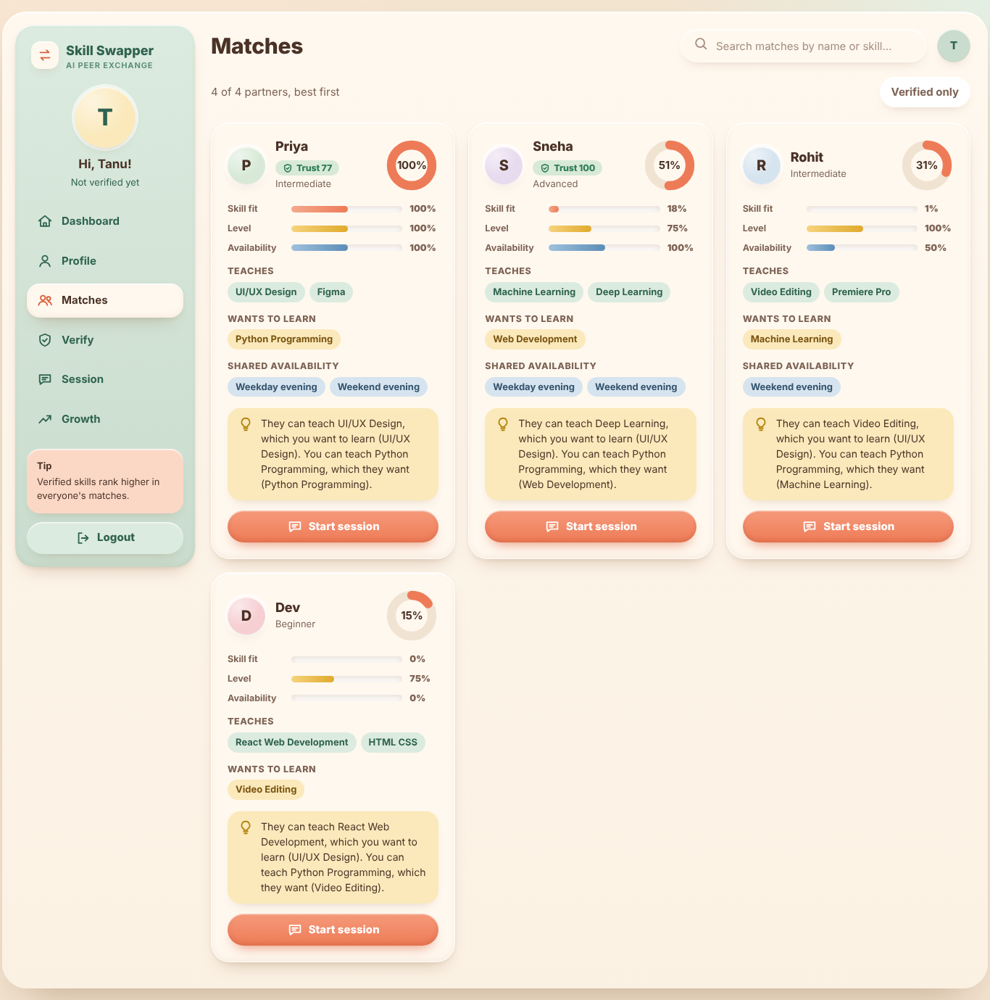
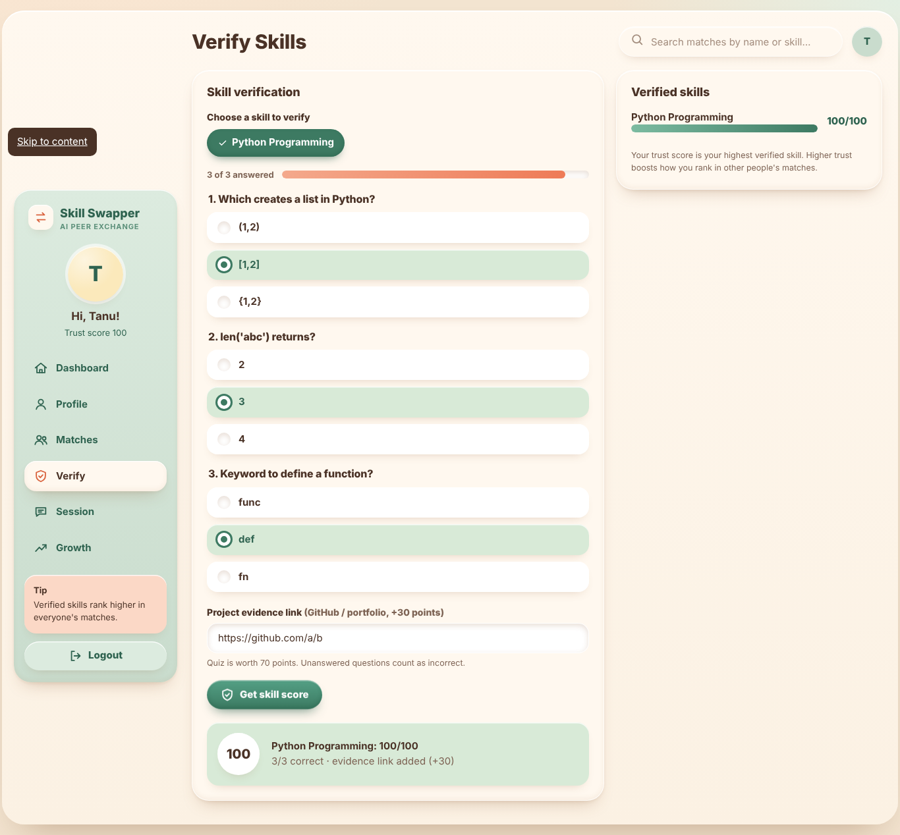
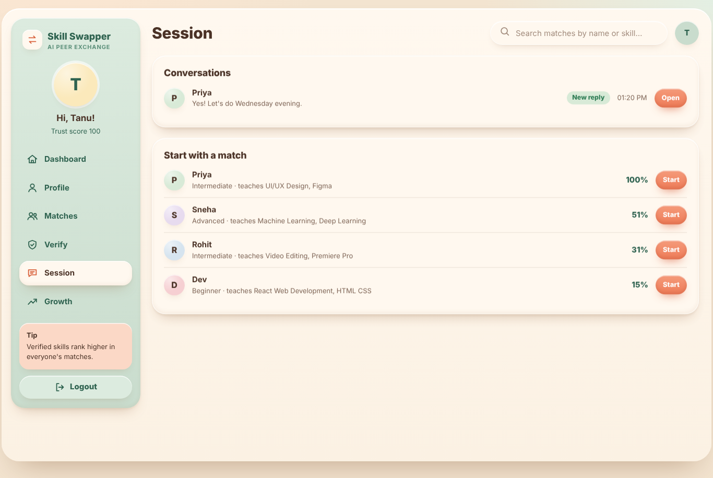
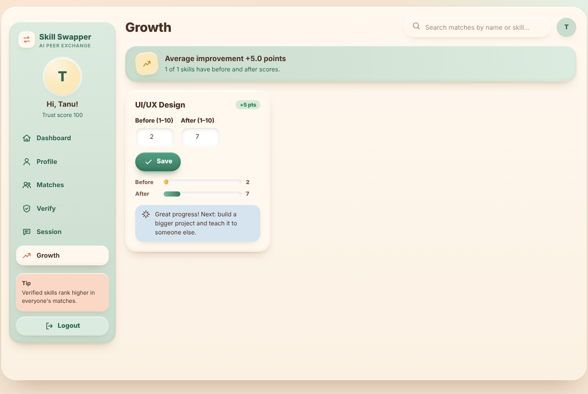
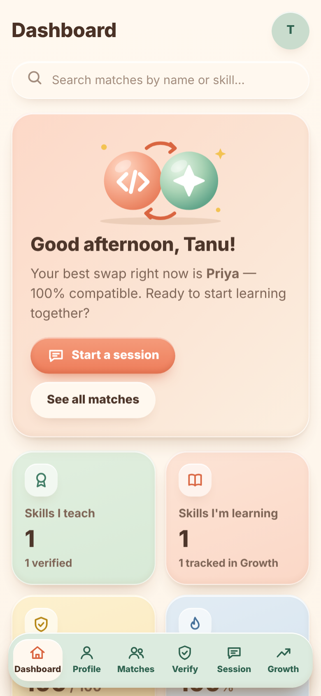

# 🔄 AI Skill Swapper

### Teach what you know. Learn what you love. Let AI find your perfect match. ✨

 

 

 

---

## 🔗 Live Project

### 👉 **[https://skillswapper-on-render.onrender.com](https://skillswapper-on-render.onrender.com/)**

Open the link, create an account, add what you can teach and what you want to learn, and get matched with real people instantly. 🎯

---

## 💡 What is AI Skill Swapper?

**AI Skill Swapper** is a peer-to-peer skill exchange platform where learners teach each other.

You list the skills you can **teach** 🎓 and the skills you want to **learn** 📚. Our AI matcher finds people whose skills fit yours in **both directions** — they teach what you want, and you teach what they want. A win-win swap, no money involved. 🤝

> 🧠 *Learning is faster when you teach.*

---

## 😩 The Problem We Solve

| ❌ The Problem | ✅ Our Solution |
|---|---|
| Online courses are expensive and one-sided | Free peer-to-peer exchange, everyone is both teacher and student |
| Hard to find the right study partner | AI ranks the best partners for you automatically |
| No way to know if a "teacher" is actually good | Skill verification quiz + project proof builds a trust score |
| Learning alone has no structure | Auto-generated 4-week study plan and revision notes |
| No way to see real progress | Before/after growth tracking with AI suggestions |

---

## 🌟 Key Features

### 🤝 AI Reciprocal Matching
Smart matching based on **skill similarity, experience level and shared availability**. Every match comes with a plain-English explanation of *why* you two fit.

### 🛡️ Skill Verification & Trust Score
Prove your skills with a quick **3-question quiz** and a **project evidence link**. Your trust score is shown on your profile so partners know they can rely on you.

### 💬 Learning Session Copilot
Everything you need for a session in one place:
- 📅 **4-week study plan**
- 📝 **Revision notes**
- 💬 **Two-way chat** with a full inbox
- 🎥 **One-click Google Meet** link

### 📈 Growth & Proof of Learning
Rate yourself **before and after**, see your improvement per skill, and get an AI-suggested next step.

### 🏠 Smart Dashboard
Your skills, trust score, best matches, growth and next suggested action — all at a glance.

### 🔗 Invite Link
Copy the site link in one click and bring your classmates in. More people means better matches. 🚀

### 🎨 Beautiful, Friendly UI
Soft pastel "clay" design • fully responsive on phone, tablet and desktop 📱💻 • searchable & filterable matches • smooth toasts, loaders and empty states • keyboard and screen-reader friendly ♿

---

## 📸 Screenshots

| 🔐 Sign in | 👤 Profile |
|---|---|
|  |  |

| 🤝 Matches | ✅ Verify |
|---|---|
|  |  |

| 🗓️ Session & messages | 💬 Chat |
|---|---|
|  |  |

| 📈 Growth | 📱 Mobile |
|---|---|
|  |  |

---

## ⚙️ How It Works

1. 📝 **Create your profile** — add skills you can teach and skills you want to learn.
2. 🧠 **AI finds your matches** — ranked by skill fit, level and availability.
3. ✅ **Verify your skills** — take the quiz, share your project, earn trust.
4. 🎥 **Start learning together** — study plan, notes, chat and Google Meet.
5. 📈 **Track your growth** — see how far you've come and what to do next.

---

## 🛠️ Tech Stack

| Layer | Technology |
|---|---|
| 🎨 **Frontend** | HTML5, CSS3, Vanilla JavaScript (ES modules) |
| ⚡ **Backend** | Python, Flask REST API |
| 🗄️ **Database** | PostgreSQL (production), SQLite (local) |
| 🤖 **AI Matching** | Semantic skill embeddings + cosine similarity, optional MiniLM (`sentence-transformers`) |
| ☁️ **Hosting** | Render |

---

## 🎯 Who Is It For?

- 🎓 **College students** who want to learn from classmates
- 💻 **Beginners** looking for a free study partner
- 🧑‍🏫 **Skilled learners** who want to teach and strengthen their own knowledge
- 👥 **Student communities and clubs** building a peer-learning culture

---

## 🏫 About

Built as **SkillSync**. 💙

### ⭐ Like the idea? Give it a star and try the live demo! ⭐

